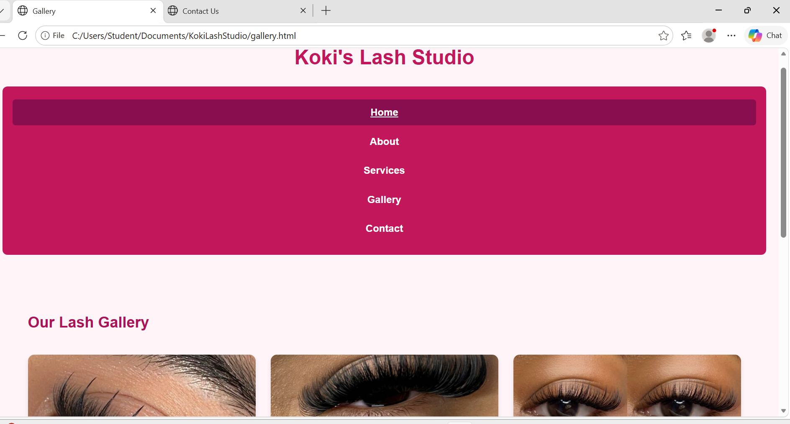
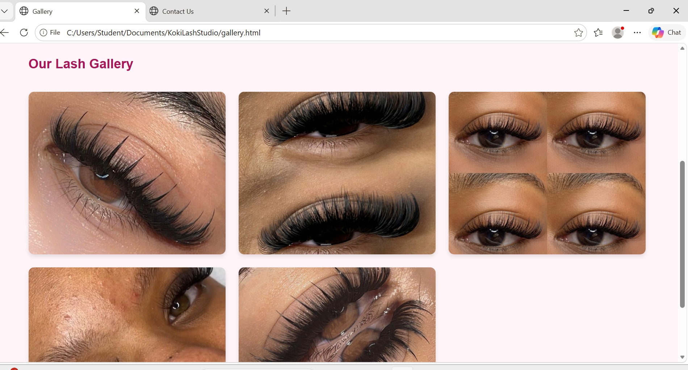
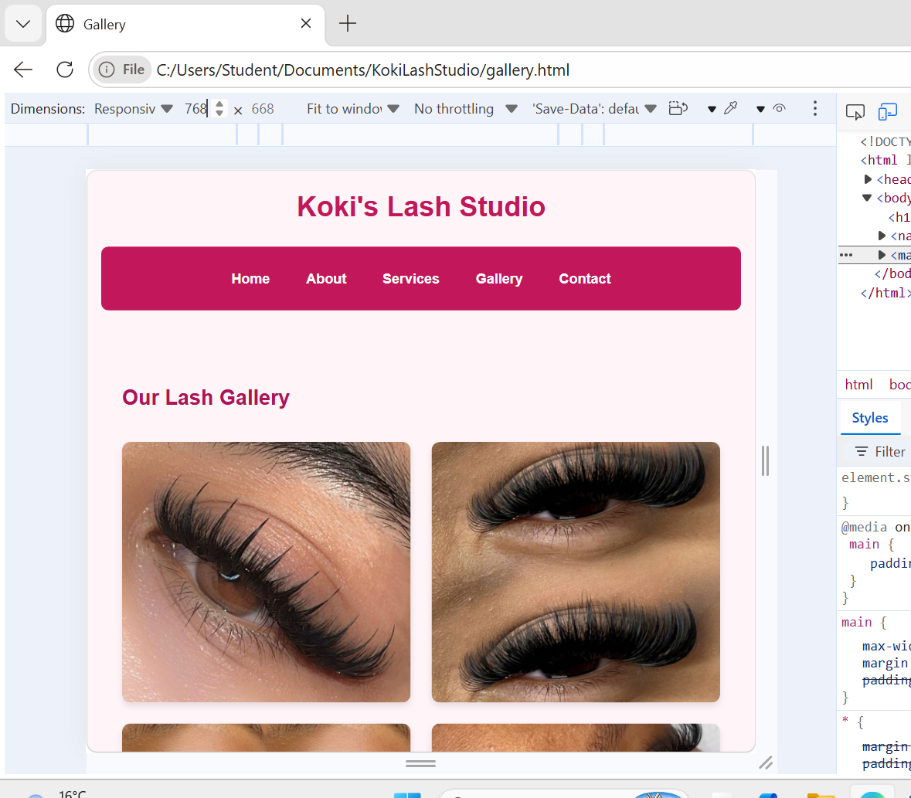
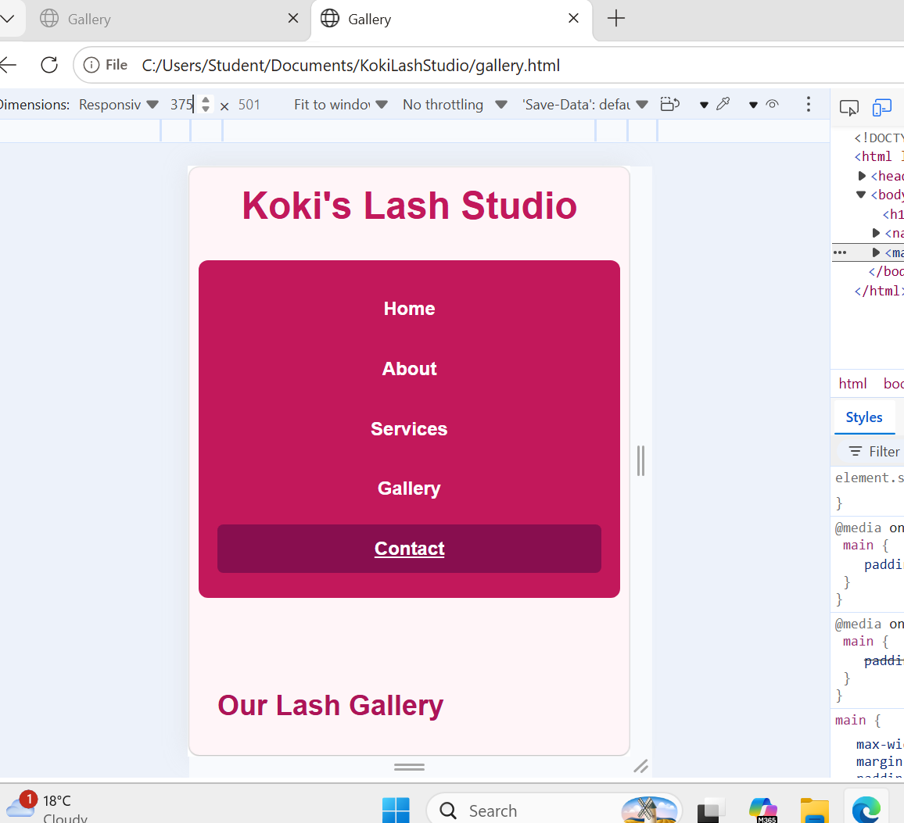
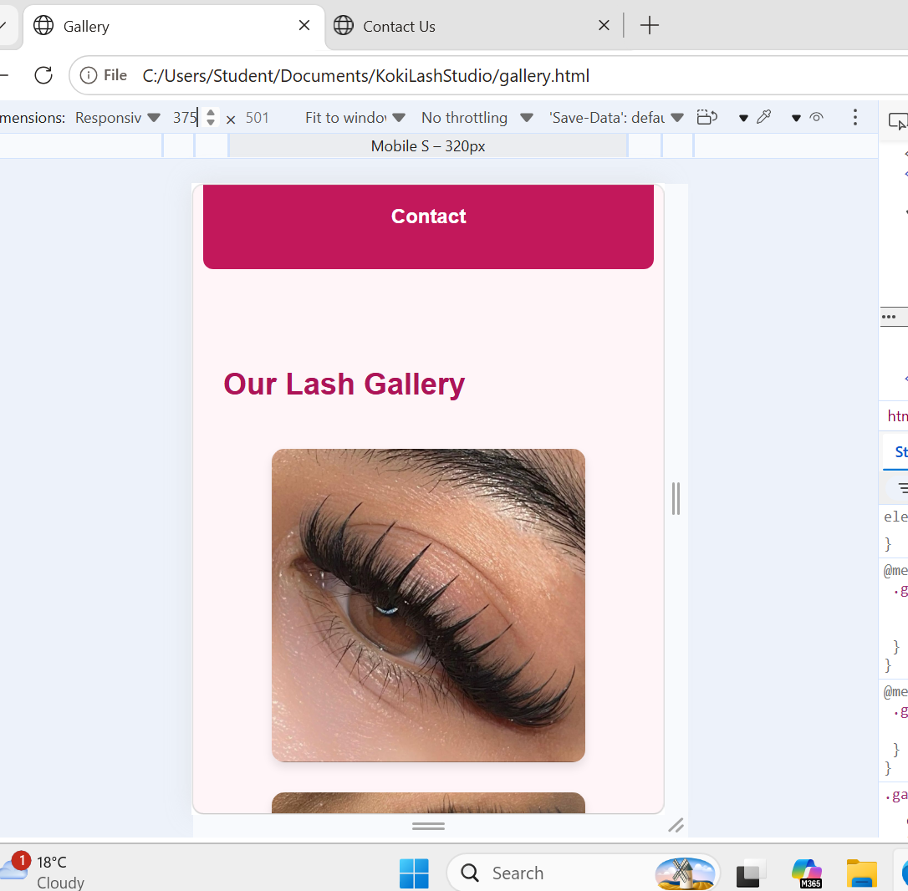

## Changelog

### Part 2 – CSS Styling and Responsive Design

- Created and linked an external `style.css` stylesheet to the website pages.
- Added a consistent pink colour scheme across the website.
- Improved typography, spacing, margins and padding.
- Styled the navigation menu and added interactive hover effects.
- Improved the layout of the Home, About, Services, Gallery and Contact pages.
- Added styled service cards to clearly display lash services and prices.
- Improved the gallery layout and made the lash images consistent in size.
- Styled the contact form, input fields and Send button.
- Added responsive design using CSS media queries.
- Added a tablet breakpoint for screens between 601px and 960px.
- Added a mobile breakpoint for screens 600px and below.
- Changed the gallery from three columns on desktop to two columns on tablet and one column on mobile.
- Changed the navigation to a vertical layout on mobile screens.
- Tested the website using Chrome Developer Tools at different screen sizes.
- Added desktop, tablet and mobile screenshots as evidence of responsive testing.

### Changes Made Based on Part 1 Feedback

- Improved the website structure and organisation based on the feedback received in Part 1.
- Improved the website content and added clearer information about Koki's Lash Studio and its services.
- Improved the visual layout of the website to make the content more organised and user-friendly.
- Improved the gallery layout and presentation of images.
- Improved the Services page by clearly presenting the available lash services, descriptions and prices.
- Improved the Contact page and added a clearly structured contact form.
- Added an external CSS stylesheet to create consistent styling throughout the website.
- Improved typography, spacing, colours and page layouts.
- Added responsive layouts for desktop, tablet and mobile devices.
- Added and improved the README documentation.
- Expanded the changelog to provide a clearer record of website development and changes.
- Added screenshot evidence showing the website at different screen sizes.
- Improved documentation to address the Part 1 feedback requesting more detail and accuracy.

Part 3 – JavaScript Functionality, SEO and Website Improvements

JavaScript Functionality

* Created script.js to add JavaScript validation to the enquiry form.
* Created contact.js to add JavaScript validation to the contact form.
* Added checks to ensure that required form fields are completed.
* Added validation to ensure enquiry and contact messages contain at least 10 characters.
* Added validation to prevent users from selecting a past appointment date on the enquiry form.
* Added feedback messages to inform users when their form is incomplete or passes validation.
* Connected the JavaScript files to their corresponding HTML pages.
* Used JavaScript event listeners to handle form submissions and prevent submission when validation fails.

Search Engine Optimisation (SEO)

* Added descriptive page titles to improve the identification of individual website pages.
* Added meta descriptions to help describe the website content in search results.
* Checked heading structure to make page content easier to understand.
* Added descriptive alternative text to gallery images to improve accessibility.
* Improved website text and corrected spelling and grammar errors.
* Maintained internal navigation links between the Home, About, Services, Gallery, Contact and Enquiry pages.

New Enquiry Page and Contact Form

* Created enquiry.html to allow visitors to enquire about lash services and preferred appointment dates.
* Added fields for the visitor’s name, email address, preferred service, appointment date and enquiry message.
* Improved the Contact page with required fields and JavaScript validation.
* Added validation feedback to both forms.
* Clarified that the forms validate information but do not yet send or store submissions.

Website Structure and Documentation

* Reviewed the HTML structure of the website pages and corrected unnecessary closing tags.
* Continued using the external style.css stylesheet to maintain consistent website styling.
* Updated the README changelog to document Part 3 development more clearly.
* Recorded the website improvements made following feedback from earlier assignment stages.

## Responsive Testing Screenshots

The website was tested using Chrome Developer Tools to ensure that it displays correctly on desktop, tablet and mobile screen sizes.

### Desktop

### Tablet – 768px

### Mobile – 375px

Part 3 Functional Testing

The website was tested using the live GitHub Pages website.

Test	Expected Result	Actual Result
Navigation links	Each link opens the correct page.	To be completed
Contact form required fields	Empty required fields are rejected.	To be completed
Contact form email	Invalid email formats are rejected.	To be completed
Contact form message	Messages shorter than 10 characters are rejected.	To be completed
Enquiry form required fields	All required fields must be completed.	To be completed
Enquiry form message	Messages shorter than 10 characters are rejected.	To be completed
Enquiry appointment date	Past dates are rejected.	To be completed
Responsive layout	Pages display correctly on desktop, tablet and mobile.	To be completed

The contact and enquiry forms currently perform client-side validation. They do not send or store submitted information. 

Live website link : https://sekobelakoketso4-web.github.io/WEDE-POE-ST10487986/

Repository link: 

## References

- W3Schools. CSS Media Queries. Used as a reference for media queries, breakpoints and responsive web design.
  https://www.w3schools.com/css/css3_mediaqueries.asp

- MDN Web Docs. Responsive Web Design. Used as a reference for responsive layouts, viewport settings and media queries.
  https://developer.mozilla.org/en-US/docs/Learn_web_development/Core/CSS_layout/Responsive_Design

- Dave Gray. CSS Media Queries & Responsive Web Design Tutorial for Beginners. YouTube. Used as additional guidance for responsive web design and testing different screen sizes.
  https://www.youtube.com/watch?v=69IbzTWg5PM

### Image Sources

The lash images used in the website gallery were sourced from Pinterest for educational purposes.

- lashes1.jpg – Pinterest
- lashes2.jpg – Pinterest
- lashes3.jpg – Pinterest
- lashes4.jpg – Pinterest
- lashes5.jpg – Pinterest

Pinterest:
https://www.pinterest.com/
